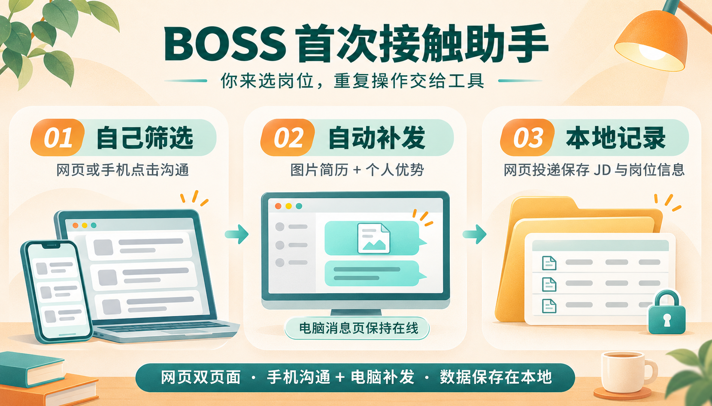

# BOSS 首次接触助手



面向 **BOSS 直聘求职者**的浏览器扩展与本地工具。你自己挑选岗位、决定是否投递并点击“立即沟通”，工具负责后续重复操作：**向新会话发送图片简历，再发送个人优势文字**。

支持两种用法：电脑网页端投递；或在手机 BOSS App 上发起沟通，由保持在线的电脑浏览器补发图片和文字。

电脑网页端建立沟通时，还会**自动保存这次投递的 JD、公司、薪资、HR 等岗位信息，并按日期统计已记录的投递数量**，方便后续回看“投过什么岗位、要求是什么、当时薪资多少”。

## 解决什么问题

点击“立即沟通”后，BOSS 会先发出平台的打招呼消息。想让 HR 进一步了解自己，往往还需要打开聊天、上传图片简历，再输入或粘贴个人优势。每联系一位新的 HR，都要重复这些操作。

本项目把这段流程串起来：提前配置好图片和个人优势，电脑消息页发现新会话后，检查是否只有自己发出的一条招呼，符合条件便依次发送图片和文字。你仍然负责筛选岗位和决定与谁沟通。

“图片简历”是发在聊天里的 JPG/PNG 图片；“个人优势”是图片后发送的一段文字。它们与 BOSS 平台发送的第一条打招呼语分开配置。

## 适合谁使用

- 在 BOSS 直聘求职，希望向新联系的 HR 补充图片简历和个人介绍的人。
- 希望自己筛选岗位、自己点击沟通，同时减少上传图片和粘贴文字操作的人。
- 习惯用手机看岗位，又能让电脑保持在线、完成后续发送的人。

工具运行在电脑浏览器中，手机端无需安装扩展。只有手机、电脑未开机或未打开网页消息页时，无法自动补发。

## 主要功能

| 功能 | 使用方式 |
|---|---|
| 自动发送图片和文字 | 消息页发现列表顶部新增会话，首次接触检查通过后自动执行 |
| 按顺序发送 | 确认图片出现在消息流后，再发送个人优势 |
| 手动发送或补发 | 面板提供“发送图片和文字”“仅发图片”“仅发文字”三个按钮 |
| 网页沟通后留在岗位页 | 识别“已向BOSS发送消息”弹窗，自动点击“留在此页” |
| 自动记录已投递岗位 | 网页沟通成功弹窗出现时，保存当时可读取的 JD、公司、薪资及 HR 信息到本地 |
| 查看投递数量与记录 | 按今天、近 7 天、本月、全部或自定义日期查看已记录的投递，并可查询和导出摘要 |

当前扩展不会自动筛选岗位、代你点击“立即沟通”，也不操作平台的“发送附件简历”功能。本发布版仅提供首次接触发送和本地岗位记录，无需配置模型或 API Key。

## 使用前准备

- 一台保持联网、能够运行浏览器的电脑；当前启动脚本面向 Windows。
- Python 3.9 或更新版本，以及 Chrome 或 Edge 浏览器。
- 已登录的 BOSS 直聘账号；手机配合电脑使用时，两端必须是同一个账号。
- 一张 JPG/PNG 格式的图片简历，大小不超过 8 MB。
- 一段准备发给 HR 的个人优势文字，最多 300 字符。

**先在 BOSS 的“消息通知—设置招呼语”等对应设置入口中开启打招呼语，建议内容设为“您好”。** 设置入口可能随平台版本调整，以实际界面为准。第一条招呼用于建立会话并同步到消息列表，工具再从电脑消息页接着处理；关闭招呼语可能导致新会话无法按预期出现。

## 安装与首次配置

### 1. 下载项目

在 GitHub 仓库页面点击 **Code → Download ZIP**，解压到电脑上的固定文件夹。仓库已公开，无需申请访问权限即可下载源码。

熟悉 Git 的使用者也可以克隆仓库：

```powershell
git clone https://github.com/Fbkybsa/boss-first-contact-helper.git
cd boss-first-contact-helper
```

后面的命令都在项目根目录执行，即能看到 `server/`、`extension/` 和 `start.bat` 的文件夹。

### 2. 启动本地服务

在终端运行：

```powershell
python server/app.py
```

Windows 上也可以双击 `start.bat`。如果终端不识别 `python`，可以尝试 `py -3 server/app.py`，或先检查 Python 安装。

服务只使用 Python 标准库，无需安装第三方运行依赖。启动后打开[图片和话术设置页](http://127.0.0.1:8787/first-contact-settings.html)。使用期间请保持服务窗口运行，关闭它会停止本地服务。

### 3. 配置图片和个人优势

在设置页选择图片简历、填写图片之后发送的个人优势文字，然后保存。此流程不需要填写模型、API Key 或完整简历文本。

初次使用时图片和文字为空，需要自行配置。修改材料后，后续发送使用新保存的配置。

### 4. 安装浏览器扩展

1. Chrome 在地址栏输入 `chrome://extensions`；Edge 输入 `edge://extensions`。
2. 打开“开发者模式”。
3. 点击“加载已解压的扩展程序”，选择项目中的 **`extension/` 文件夹**。
4. 打开或刷新 BOSS 网页消息页，确认右上角出现“首次接触 · 自动沟通”面板。

更新扩展文件后，需要在扩展管理页点击“重新加载”，并刷新已打开的 BOSS 岗位页和消息页。

## 方式一：电脑网页端投递

在安装了扩展的同一个浏览器配置中，打开两个标签页或两个窗口：

| 页面 | 用途 |
|---|---|
| [BOSS 岗位页](https://www.zhipin.com/web/geek/jobs) | 自己浏览岗位、判断是否适合，并点击“立即沟通” |
| [BOSS 消息页](https://www.zhipin.com/web/geek/chat) | 保持打开，等待新会话并自动补发图片与个人优势 |

操作顺序：

1. 先启动本地服务、打开消息页，等待面板显示“正在监听新会话”。
2. 再到岗位页筛选岗位，决定投递后点击平台的“立即沟通”。
3. 平台发出第一条招呼并弹出“已向BOSS发送消息”时，扩展会保存网页岗位快照，再点击“留在此页”，方便你继续浏览。
4. 另一个消息页发现列表顶部新增会话后，会点开检查。符合条件时先发图片，确认后等待至少 0.5 秒，再发个人优势文字。
5. 面板显示“图片和话术均已发送”才算本次流程完成。首次使用建议同时查看实际消息流，确认两条内容均已出现。

发送过程中请不要手动切换电脑消息页的会话，也不要在该会话中另外发送消息，否则工具可能停止后续步骤。岗位页与消息页相互独立，可以继续在岗位页浏览。

## 方式二：手机投递，电脑自动补发

手机与电脑登录同一个 BOSS 账号，手机负责浏览岗位和点击沟通，电脑处理同步过来的新会话。

1. 在电脑启动本地服务，并在安装了扩展的浏览器中打开 BOSS 消息页。
2. 等待面板显示“正在监听新会话”，保持电脑联网、浏览器运行，避免休眠。
3. 在手机 BOSS App 上筛选岗位，确认要投递后点击“立即沟通”，让平台先发送已开启的打招呼语。
4. 新会话同步到电脑网页消息列表顶部后，工具会按相同规则检查，并发送图片简历和个人优势。
5. 在电脑或手机的对应会话中核对结果。

此方式依赖 BOSS 将手机新会话同步到电脑网页端。**新会话没有同步到电脑消息列表时，工具无法处理。** 可先查看电脑消息页和面板状态，再决定是否手动补发。

手机模式无需另外打开电脑岗位页。由于扩展没有读取手机上的岗位页面，也没有收到电脑网页沟通成功弹窗，**此模式不保证保存完整 JD 快照**。自动补发与网页岗位快照是两项独立功能。

## 手动发送与遗漏补发

### 收起和移动面板

大面板右上角点击“收起”会变成“沟通助手”小按钮，点击小按钮可展开。大面板拖动标题栏移动，小按钮拖动自身移动；拖动不会误触展开，位置和展开状态在刷新后恢复。窗口缩小时会重新限制在可见范围内。收起只隐藏界面，自动监听和已开始的发送仍继续按原规则运行。

在电脑消息页打开目标会话，核对收件人后，可使用右上角面板：

| 按钮 | 适用场景 |
|---|---|
| 发送图片和文字 | 手动向当前会话发送整套内容 |
| 仅发图片 | 当前会话缺少图片，或只需要发送图片 |
| 仅发文字 | 图片已成功发出，但个人优势遗漏，需要单独补发 |

手动按钮不限制是否首次接触；对方已回复、会话已有历史、以前已发送过，也可以再次发送。点击前请自行确认是否需要重发。工具仍会保护未发送草稿，并在会话切换或发送结果无法确认时停止后续步骤。

## 自动发送的条件与边界

自动模式只处理**消息页开始监听之后，列表顶部新增的会话**，不会扫描历史列表逐个补发。

| 场景 | 自动模式的处理 |
|---|---|
| 只有自己发出的一条非空文字，且公司、HR、岗位、消息标识和控件可识别 | 允许发送 |
| 对方已有回复，但自己仍只有第一条招呼 | 仍允许发送 |
| 自己已发第二条消息，或已有图片、简历相关系统记录 | 停止自动发送，可自行决定是否手动发送 |
| 消息页初次打开或刷新时，列表中已存在的会话 | 作为初始列表，不自动发送 |
| 旧会话仅发生最新消息预览变化 | 不视为新增会话 |
| 新会话正在加载 | 最多等待 3 秒；仍无法确认时停止并提示原因 |
| 输入框有未发送草稿 | 保留草稿并停止 |
| 图片未确认成功 | 不继续发文字，也不自动重试图片 |
| 图片确认后的等待期间切换会话，或自己又发出消息 | 停止后续文字发送 |
| 同一会话已进行过自动发送尝试 | 不自动重发，必要时使用手动按钮 |
| 出现平台验证、控件缺失或未知消息类型 | 停止并显示原因 |

## 常见问题

### 点击“立即沟通”后没有自动发送？

确认平台打招呼语已开启、本地服务仍在运行，以及电脑消息页已提前打开并进入监听状态。再检查新会话是否出现在电脑消息列表顶部、面板是否显示具体停止原因。

如果打完招呼才打开或刷新消息页，该会话已属于初始列表，工具不会自动补发。打开目标会话后，使用手动按钮即可。

### 图片发送了，文字没有发送？

先查看实际消息流，确认图片已发送成功。如果图片存在而文字缺失，点击“仅发文字”补发即可，避免重复发图。常见停止原因包括发送中切换会话、另外发出消息、输入框有草稿或无法确认图片结果。

### 消息页没有扩展面板？

确认已加载项目的 `extension/` 文件夹，且当前打开的是电脑网页版消息页。重新加载扩展后还需要刷新 BOSS 页面。手机 App 本身不会出现此面板。

### 设置页打不开或提示本地服务未启动？

检查服务终端是否仍在运行，能否打开[本地设置页](http://127.0.0.1:8787/first-contact-settings.html)。扩展更新后若提示连接已断开，刷新电脑消息页再试。

### 可以直接用 PDF 简历吗？

当前发送的是聊天图片，请自行准备不超过 8 MB 的 JPG/PNG。工具不会自动把 PDF 转成图片，也不操作平台的附件简历投递流程。

## 自动记录已投递岗位：保存哪些内容

### 什么时候记录，如何算一次投递

你在电脑岗位页点击“立即沟通”，平台出现“已向BOSS发送消息”成功弹窗后，扩展会读取当前岗位信息并保存快照，再处理“留在此页”。记录的是**建立沟通当时页面可读取的内容**，方便之后回看当时的 JD。

本项目按“**成功建立沟通即算投递**”统计，平台原始阶段仍保留为“已沟通”。后续补发图片简历或个人优势，不另算一次投递。这里的记录不代表 HR 已审核、已收到平台附件简历或已进入面试。

### 自动保存的字段

| 类别 | 保存内容 | 对应字段 |
|---|---|---|
| 岗位标识 | 岗位名称、职位 ID、职位链接 | `title`、`job_key`、`url` |
| JD 正文 | 页面可读取的职位描述文本，通常包括岗位职责、任职要求 | `jd_text` |
| 任职要求与标签 | 工作经验要求、学历要求、页面岗位标签 | `experience`、`education`、`job_tags` |
| 公司信息 | 公司名称、规模、所属行业、融资阶段 | `company_name`、`company_size`、`industry`、`financing_stage` |
| 工作地点 | 城市、详细工作地址 | `city`、`address` |
| 薪资 | 可读薪资文本、薪资下限与上限（千元/月）、发薪月数 | `salary_raw`、`salary_min_k`、`salary_max_k`、`salary_months` |
| 薪资原始依据 | 网页原始字符、字符码点、字体、读取或解码状态及方法 | `salary_dom_raw`、`salary_codepoints`、`salary_font_family`、`salary_capture_status`、`salary_decode_method` |
| HR 信息 | HR 姓名、职务、活跃度原文及其采集时间 | `job.hr.name`、`job.hr.title`、`job.hr.activity_text`、`job.hr.activity_captured_at` |
| 沟通与采集记录 | 本次事件标识、采集时间、来源、沟通成功文案、留页按钮是否点击 | `event_id`、`captured_at`、`source`、`action` |
| 数据完整性 | 采集成功或失败、缺失字段、解析提示 | `capture.status`、`capture.missing_fields`、`capture.warnings` |

字段取决于当时页面实际提供的信息，**不保证每个岗位都能采齐**。HR 活跃度是采集时看到的状态，不是持续更新的在线状态。薪资遇到字体混淆时会保留原始依据；可识别规则会解码，无法解析的数值保持为空，不猜测。

### 在哪里查看和统计

| 目的 | 查看方式 |
|---|---|
| 查看投递数量和岗位列表 | 打开[本地管理页](http://127.0.0.1:8787/)，选择今天、近 7 天、本月、全部或自定义日期 |
| 找到某次投递 | 管理页搜索公司或岗位，结合阶段、行业、公司规模、薪资等条件筛选；点击记录查看详情 |
| 查看保存的 JD 正文及完整快照 | 打开[最近 20 条岗位快照](http://127.0.0.1:8787/api/contact-snapshots?limit=20)，在返回的 `items` 中查看 `job.jd_text` 及其他字段；当前为 JSON 展示 |
| 导出岗位摘要 | 点击管理页“导出 CSV”，或打开[CSV 导出接口](http://127.0.0.1:8787/api/export.csv)，下载后用 Excel 打开；当前 CSV 包含公司、岗位、薪资、阶段、时间、HR 等摘要，不包含 JD 正文及全部快照字段 |

投递统计按本地投递记录及投递起点日期计算，管理页也提供近 8 周趋势。**快照事件条数与投递记录数不是同一个指标**：相同事件重复上报不会重复保存，快照接口的总数还可能包含失败采集事件，不能直接当作投递岗位数。

### 采集范围与可能漏记的情况

- 只统计本地实际记录到的投递，不会自动补齐你启用工具之前的全部历史投递。
- 手机发起沟通时，电脑可以补发图片和文字，但未读取手机上的岗位详情，因此不保证自动保存对应的完整 JD 或计入这条网页快照链路的投递统计。
- 缺少职位 ID、岗位名称或 JD 正文时，会保存失败事件及缺失原因，不创建正常投递记录；其他页面未提供的字段可能为空。
- 本地服务短暂不可用时，扩展会将快照暂存在浏览器本地并重试。服务恢复前，新记录可能尚未出现在管理页中。
- 管理页中的后续回复、查看和面试指标依赖实际已记录或人工维护的进展；当前发送流程不会自动持续跟踪所有后续状态。

## 本地数据与隐私

默认运行数据保存在电脑上的 `db/` 目录，浏览器扩展也会在本地保存处理状态。你的简历、图片、打招呼语、个人优势、聊天记录、JD、公司与 HR 记录、私密配置、数据库、日志及原始网页均不随仓库分发，相关文件已配置 Git 忽略规则。测试目录仅保留虚构占位数据与算法测试数值。

本发布版没有模型调用功能，不要求提供完整简历文本或模型服务密钥。

### 上传前如何检查个人信息

完整步骤见[隐私自查与后续上传规则](PRIVACY.md)，包括检查 Code 文件树、README 和测试样例、图片、Commits 历史、提交邮箱，以及 Issue/PR/Release 附件。

每次同步只上传 `release-files.txt` 白名单中的文件，并先运行：

```powershell
python tools/check_release_privacy.py --worktree
```

真实简历、话术、JD、岗位记录和截图仅留在本地，后续变更同样不上传。图片简介由 AI 生成，只展示通用流程，不使用个人材料。自动检查仍需配合人工审阅新增文案和图片；删除当前文件也不会自动删除旧提交中的内容。

## 开发与验证

运行服务只需要 Python 标准库。执行 JavaScript 单元测试另需 Node.js 18 或更新版本：

```powershell
node --test tests/first_contact.test.js tests/background_minimal.test.js tests/stay_on_page.test.js tests/stay_on_page_dom.test.js tests/job_snapshot.test.js
node --test tests/floating_panel.test.js
python tests/smoke.py
```

这些测试不访问 BOSS 账号，也不发送真实消息。真实页面 HTML 含个人信息，不随仓库提供。`tests/message_page_dom.py` 与 `tests/validate_selectors.py` 是可选的私有样本验证工具；自行准备对应样本到 `docs/samples/`，安装 `beautifulsoup4` 和 `soupsieve` 后才能执行。缺少样本不能视为选择器验证已通过。

规格按 OpenSpec 的 proposal → spec → design → tasks 组织，参见[首次接触发送规格](openspec/changes/first-contact-message-send/)和[岗位快照规格](openspec/changes/record-contact-job-snapshot/)。每次修改、原因、验证结果及待验证事项记录在 [CHANGELOG.md](CHANGELOG.md)。

## 许可证与项目状态

仓库已于 2026-11-09 经所有者确认公开，随仓库提供 [MIT License](LICENSE)。

本项目为非官方工具，与 BOSS 直聘无隶属关系。扩展依赖网页结构，平台改版后可能需要调整。请结合面板提示和实际消息流确认结果，并遵守平台规则。
